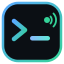

<p align="center">
  
</p>

<h1 align="center">S-remote</h1>

<p align="center">
  <b>Your terminals live on your PC. Pick them up from any browser or phone.</b><br>
  Direct over <a href="https://tailscale.com">Tailscale</a> — no relay server, no account, no cloud.
</p>

<p align="center">
  <a href="https://github.com/thsangyk-oss/sremote/releases/latest"></a>
  
  
  
</p>

<p align="center">
  <b>☕ Ủng hộ tác giả cốc cafe mua token</b><br>
  
</p>

<p align="center">
  
</p>

Start a build, a dev server, a training run or an AI coding agent on your
workstation. Walk away. Open the **same live session** from a laptop's browser
or from your phone and keep typing — the shell never stopped, the scrollback
is all there, and it survives even an S-remote restart.

---

## Highlights

- **Sessions that never stop** — PTYs live in a separate broker process; closing the tab, losing Wi-Fi or updating S-remote doesn't kill them.
- **Built for many projects** — search-first home, project tree, `Ctrl+K` palette in most-recently-used order, live activity dots.
- **A real terminal on your phone** — xterm.js with a key bar (Esc, Tab, Ctrl, arrows…), a command box, swipe/Back navigation and an Android app.
- **Remote desktop** — mouse, keyboard, clipboard, multi-monitor; trackpad mode for phones. Native DXGI capture with flow control.
- **Files** — explore the whole machine, upload/download (folders auto-zip), extract archives, preview code, Markdown, images, HTML and video.
- **Private by design** — only tailnet (`100.64.0.0/10`) and localhost may connect; everything else gets a 403 before reaching the app.

---

## Tour

### Home — find any project or session in a keystroke

Type anywhere to search projects and sessions (fuzzy, highlighted). Cards show each project's live sessions as chips — click one to jump straight in, `+` opens a new terminal there. Filter All / Active / Pinned, sort Recent / A–Z, hover the **i** for the full path and git status.

<p align="center"></p>

### Terminal — the whole machine in one sidebar

The sidebar is a tree of every project and session with its own filter, so switching projects never means going back home. Dots tell you what's happening: **green pulse** = output right now, **blue** = new output you haven't seen, **amber** = bell / needs you. The files panel and git diff sit on the right.

<p align="center"></p>

### `Ctrl+K` — jump to anything

Sessions in most-recently-used order (the previous one is always first, so `Ctrl+K` `Enter` flips back), then projects and actions.

<p align="center"></p>

### On your phone

Two project cards per row, one-tap session chips, a key bar for the keys phones don't have, and Back / edge-swipe returns to the project list instead of leaving the app.

<table>
  <tr>
    <td align="center" width="33%"><br><sub>Home</sub></td>
    <td align="center" width="33%"><br><sub>Live session + key bar</sub></td>
    <td align="center" width="33%"><br><sub>Project tree</sub></td>
  </tr>
</table>

### Remote screen — really control the desktop

Opens in its own tab. On a PC your mouse and keyboard go straight to the host (fullscreen also captures Win, Alt+Tab and Esc). On a phone, **trackpad mode** turns the screen into a laptop touchpad: drag to move the pointer, tap to click, two fingers to scroll or right-click, pinch to zoom; a rotate button forces landscape and the keyboard never covers the spot you're typing into.

<p align="center"></p>
<p align="center"></p>

### Files — explore, transfer, preview

A full explorer for the whole machine: drives and shortcuts, multi-select, drag-drop upload up to 4 GB, folders download as zip, extract / compress, copy-cut-paste, *Open terminal here*. Previews render Markdown, images, **HTML pages** (with their CSS/JS) and **video/audio** with seeking.

<table>
  <tr>
    <td align="center" width="33%"><br><sub>Explorer</sub></td>
    <td align="center" width="33%"><br><sub>HTML preview</sub></td>
    <td align="center" width="33%"><br><sub>Video preview</sub></td>
  </tr>
</table>

---

## Install

**Requirements:** [Tailscale](https://tailscale.com/download) on every device (same tailnet). Node.js 18+ is installed automatically on Windows if missing.

### Windows (one command)

Run in PowerShell — installs, or updates in place keeping your projects and sessions:

```powershell
irm https://raw.githubusercontent.com/thsangyk-oss/sremote/main/install.ps1 | iex
```

Then open from any device in your tailnet:

```
http://<machine-tailscale-ip>:2209
```

The installer downloads `sremote-server.zip` from the latest [release](https://github.com/thsangyk-oss/sremote/releases), installs portable Node.js if needed, runs `npm install --omit=dev`, compiles the tray app, registers the `S-remote` autostart task and starts the server.

<details>
<summary><b>Installer options, duplicates, admin sessions, firewall</b></summary>

- Install dir defaults to `%LOCALAPPDATA%\S-remote` — override with `$env:SREMOTE_DIR`.
  Skip the overwrite prompt with `$env:SREMOTE_YES=1`; preview detection only with `$env:SREMOTE_PROBE_ONLY=1`.
- **Several installs found?** (e.g. an old bad update dropped a copy into `%LOCALAPPDATA%`) it asks:
  - `[1]` fresh install into the currently-running dir — others stay untouched, their workspaces are **not** migrated
  - `[2]` fix + install into the original dir — keeps workspaces, re-attaches live sessions, merges newer state from the duplicate, then stops the duplicate *(default)*

  Pre-answer with `$env:SREMOTE_MODE = 'fresh'` or `'fix'`.
- **The installer never deletes folders.** Duplicates are only stopped and listed for you to remove by hand. A dir counts as an install only when a running / registered S-remote points at it (server, session broker, tray, autostart task or Run key), or — for dirs found by scanning the disk — when it carries the `.sremote-install` marker every install writes (or is the default `%LOCALAPPDATA%\S-remote`). Source checkouts (`.git`), forks and copies of the project are never picked up by the scan.
- **Workspaces gone after updating to v1.10.x or older?** Those installers could miss a custom install dir and install fresh under `%LOCALAPPDATA%`. Your old install is still on disk — update it in place and stop the duplicate:

  ```powershell
  irm https://raw.githubusercontent.com/thsangyk-oss/sremote/main/fix-state.ps1 | iex
  ```
- **Admin rights in every terminal session?** Sessions inherit the token of the chain task → tray → server → PTY. Elevate the autostart task once (self-elevates, restarts the chain; live sessions end, workspaces are kept):

  ```powershell
  irm https://raw.githubusercontent.com/thsangyk-oss/sremote/main/elevate.ps1 | iex
  ```

  New installs run from an elevated shell do this automatically; set `$env:SREMOTE_LIMITED=1` before `irm` to opt out.
- **Firewall:** `install.bat` / an elevated installer adds the rule. Manually, limited to the Tailscale interface:

  ```powershell
  New-NetFirewallRule -DisplayName "S-remote" -Direction Inbound `
    -Program "C:\Program Files\nodejs\node.exe" -LocalPort 2209 -Action Allow `
    -InterfaceAlias "Tailscale"
  ```
</details>

### Linux (one command, headless)

Terminals, files, git, dev ports — everything except remote screen (Windows-only). Installs, or updates in place keeping your projects and sessions:

```bash
curl -fsSL https://raw.githubusercontent.com/thsangyk-oss/sremote/main/install.sh | sudo bash
```

- With sudo: installs to `/opt/sremote` as a systemd service running as **you** (`$SUDO_USER`; override with `SREMOTE_USER=name`). Without sudo (`| bash`): `~/.local/share/sremote` + a `systemctl --user` service.
- Uses Node 18+ from `PATH`, else downloads portable Node 22 into the install dir. Build tools for `node-pty` are installed only if no prebuilt binary fits.
- `KillMode=process` — restarts/updates keep the session broker, so shells survive.
- Options: `SREMOTE_DIR`, `SREMOTE_PORT`, `SREMOTE_REF` (branch/tag). Logs: `journalctl -u sremote`. Uninstall: `curl -fsSL …/install.sh | sudo bash -s -- --uninstall`.
- Tailscale must be up on the host (`curl -fsSL https://tailscale.com/install.sh | sh && sudo tailscale up`) — only localhost and tailnet clients are accepted.

### macOS / from source

```bash
git clone https://github.com/thsangyk-oss/sremote && cd sremote
npm install          # node-pty needs a prebuilt binary for your platform
node server.js       # port 2209 by default (env PORT / SREMOTE_PORT)
```

<details>
<summary><b>Autostart (systemd / launchd)</b></summary>

**Linux (systemd):**

```ini
[Unit]
Description=S-remote
After=network.target tailscaled.service

[Service]
ExecStart=/usr/bin/node /opt/S-remote/server.js
Restart=always
User=you

[Install]
WantedBy=multi-user.target
```

**macOS (launchd):** create `~/Library/LaunchAgents/com.S-remote.plist` with a `KeepAlive` ProgramArguments entry pointing at `server.js`.
</details>

### Android app

A native client — hosts list, live session notifications, and the web UI in a full-screen view with keyboard handling and file downloads. Grab the APK from the [releases](https://github.com/thsangyk-oss/sremote/releases) page (latest APK ships with v1.11.3). Any mobile browser works too.

### CLI / agents

Let a coding agent (or a script) on another tailnet machine open and drive sessions on this host — they show up live in the web UI, so you can watch or take over. No deps, Node 18+:

```bash
curl -o sremote.js http://<host>:2209/cli/sremote.js
export SREMOTE_HOST=<host>                       # tailscale IP / MagicDNS name
id=$(node sremote.js new --cwd 'C:\proj' --name agent-task)
node sremote.js run $id -- git status            # waits, prints output, exits with its code
node sremote.js send $id npm run dev             # fire and forget
node sremote.js wait $id --for "ready in"        # block until output matches
node sremote.js key $id ctrl-c
node sremote.js kill $id
```

Easiest: just tell the agent *"read `http://<host>:2209/remote.md` and work on that machine"* — the page is generated by the host (name, address, shells, projects, rules) and walks the agent through the rest.

REST underneath: `POST /api/sessions/:id/input` and `GET /api/sessions/:id/output?since=&wait=` (plain text, long-poll).

---

## How it works

```
 phone / laptop browser ──Tailscale WireGuard──▶ server.js :2209 ──pipe──▶ session-host ──ConPTY/PTY──▶ shells
                                                 (web UI + API;             (broker; owns the PTYs,
                                                  restartable)               outlives the server)
```

No signaling, no TURN, no tunnel. Pairing = being on the same tailnet.

<details>
<summary><b>Sessions survive server restarts</b></summary>

PTYs are owned by `agent/session-host.js` — a detached broker daemon the server spawns on demand and talks to over a per-install named pipe (`\\.\pipe\sremote-sessions-*`) / unix socket (`data/host.sock`). Restarting or updating `server.js` only drops the WebSocket layer; shells and everything running inside them (dev servers, agents, builds) keep running, and scrollback buffers stay resident. Broker crash → server respawns it; sessions restore from `data/sessions.json` + `data/scrollback/` (respawned shells).
</details>

<details>
<summary><b>Tray app (Windows, no console window)</b></summary>

`agent/tray/SremoteTray.cs` compiles at install time to a `/winexe` binary — zero console windows. It sits in the notification area (green = running, gray = stopped) and owns the `node server.js` child. Right-click: **Open Web UI**, **Start / Stop server**, **Start with Windows**, **Exit**. The scheduled task / `start.cmd` / Run key all prefer the tray exe; without it `start /min node server.js` is used. Manual task:

```powershell
schtasks /create /tn "S-remote" /tr "C:\path\to\S-remote\agent\tray\SremoteTray.exe" /sc onlogon /rl limited /f
```
</details>

<details>
<summary><b>Remote screen internals</b></summary>

`agent/screen-pro/ScreenPro.cs` is compiled on the host with the `csc.exe` that ships with .NET Framework (no download, ~30 KB exe). The server builds it the first time the screen is opened and again whenever the source changes (`ScreenPro.ver` holds the source hash).

- **Capture:** DXGI Desktop Duplication of the chosen monitor (event driven, idle desktop ≈ zero traffic); GDI BitBlt for "all screens", when duplication is unavailable, or when a driver returns all-black frames. UAC / lock screen interrupts DXGI — the agent falls back and retries. DPI aware, so scaled displays click exactly.
- **Encoding:** 64 px tile diffing, dirty tiles merged into row runs and JPEG encoded; tiles sent at low quality are re-sent sharp once the screen settles.
- **Flow control:** every frame costs a credit; the server grants credits as viewers ack (max 2 in flight), so a slow link never queues old frames — changes coalesce and latency stays low.
- **Cursor** is not baked into frames: position (60 Hz) and shape go out as JSON and the viewer draws it locally (on a PC your own pointer takes the host cursor's shape).
- **Input** via `SendInput` (absolute virtual-desktop mouse, vk + scan-code keys, Unicode text). `BlockInput` needs the elevated task. `Ctrl+Alt+Del` and secure-desktop prompts are not reachable (Windows security boundary).
- **Clipboard** both ways, also over plain `http://`: Ctrl+V sends this device's clipboard first (browser paste event); host copies offer a one-tap Copy.
- **Fallback:** when the agent can't be built, the page uses the PowerShell agent (`agent/screen-agent.ps1`, GDI+ shots + SendKeys) in basic mode.
- **Protocol:** `{type:"screen", pro:true, op}` with `sub {flow,w,q,fps,mon}` / `unsub` / `ack` / `config` / `mon` / `refresh` and input ops `move`, `mrel`, `down`/`up`/`click {b}`, `wheel {dy,dx}`, `kd`/`ku {vk}`, `combo`, `type`, `clip`, `block`; frames arrive as binary `F` messages, `info` / `cur` / `shape` / `clip` as JSON.
</details>

<details>
<summary><b>File explorer details</b></summary>

- Download: file → direct; folder or multi-select → auto-zipped first.
- Upload: up to 4 GB per file, progress bar, into the current folder.
- Archives: **Extract** (zip/tar/tgz/7z/rar via bsdtar, Expand-Archive fallback) and **Compress → zip**.
- Copy/Cut/Paste (cross-drive moves handled), rename, delete, mkdir, new file, copy-path, **Open terminal here**.
- Deep link `#fx` or `#fx=C:\path` opens the explorer at that folder.
- Preview: text/code (first 512 KB), Markdown, images, HTML + PDF (sandboxed, relative assets via `/raw/<base>/<path>`), video/audio with HTTP Range seeking.
- `base=@abs` unlocks absolute paths in `/api/files`, `/api/file`, `/api/upload`, `/api/fileop`. Anyone reaching the UI already has full shell access, so this exposes nothing new.
</details>

<details>
<summary><b>Platform notes</b></summary>

- **Windows:** shells are `powershell` / `cmd` / `pwsh`; the folder picker scans drives `A:`–`Z:`. Remote screen is Windows-only.
- **Linux/macOS:** shells are detected from `$SHELL` plus `/bin/bash`, `/usr/bin/zsh`, `/bin/zsh`, `/bin/sh` (and `pwsh` if on PATH); the folder picker lists `/` and `~`.
</details>

<details>
<summary><b>HTTP API</b></summary>

Base for file/git endpoints is `base=` — `ws:<workspace-id>`, an absolute directory, or `@abs`. Paths are jailed under the base.

| Method | Path | Purpose |
|---|---|---|
| GET | `/api/info` | Host info: hostname, tailscale IP, available shells |
| GET | `/api/browse?path=` | Dir listing for the folder picker (drives when empty) |
| POST | `/api/mkdir` | `{parent, name}` — create directory |
| GET/POST | `/api/workspaces` | List / create workspace `{path, name}` |
| PATCH/DELETE | `/api/workspaces/:id` | Rename `{name}` / remove workspace |
| GET | `/api/files?base=&path=` | List directory under base |
| GET | `/api/file?base=&path=` | Read file (`&dl=1` attachment, `&head=1` first 512 KB, HTTP Range) |
| GET | `/raw/<base>/<path>` | Path-style file access (HTML previews resolve relative assets) |
| POST | `/api/upload?base=&name=&dir=` | Raw-body upload into `<base>/<dir>` (default `temp-upload`) |
| POST | `/api/fileop` | `copy` / `move` / `rename` / `delete` / `mkdir` / `extract` / `zip` … |
| GET/POST | `/api/sessions` | List / create PTY session `{shell, cwd, workspace, name}` |
| DELETE | `/api/sessions/:id` | Kill session |
| GET | `/api/peers` | Tailnet peers + probe of their S-remote instance |
| GET | `/api/devports` | Listening TCP ports + owning process name |
| GET | `/api/git?base=` | `{isRepo, branch, changed}` for a base dir |
| GET | `/api/gitdiff?base=` | `{stat, diff, truncated}` vs `HEAD` (diff capped ~256 KB) |
| GET/POST | `/api/screen-pro` | Native screen agent status / build |
| WS | `/ws` | Terminal I/O: `attach` / `in` / `out` / `resize` / `create` / `rename` / `kill`; `activity` broadcasts; screen share `type:"screen"` |

Uploads that land in `<base>/temp-upload/` are added to `.git/info/exclude` when the base is a git repo, and files there are swept after 7 days.
</details>

<details>
<summary><b>Repository layout</b></summary>

| Path | Purpose |
|---|---|
| `server.js` | HTTP + WS server, PTY session API, file/git/screen endpoints (single file) |
| `agent/session-host.js` | Session broker daemon — owns PTYs + scrollback across server restarts |
| `public/` | Web UI — home, terminal, file explorer (`index.html`, `app.js`, `style.css`) |
| `public/screen.html` | Remote screen page — `screen.js` / `screen.css` |
| `agent/screen-pro/ScreenPro.cs` | Native screen agent (DXGI capture, SendInput), built on the host on first use |
| `agent/screen-agent.ps1` | PowerShell screen agent — basic-mode fallback |
| `agent/tray/SremoteTray.cs` | Windows tray host (compiled at install) |
| `android/` | Native Android client |
| `install.ps1` / `fix-state.ps1` / `elevate.ps1` | Windows installer, recovery, elevation |
| `state.json`, `data/` | Your workspaces, session records and scrollback (auto-created, kept across updates) |
</details>

<p align="center"><sub>Screenshots come from a demo instance with sample projects; the remote-screen picture shows a staged desktop.</sub></p>
